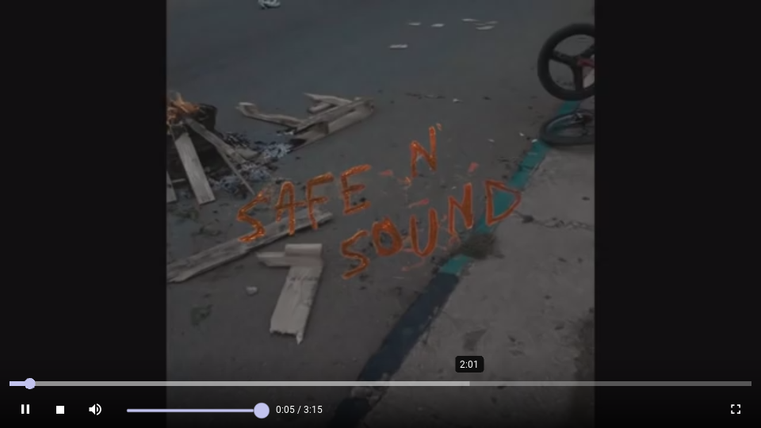

# KvyMD Video Player

This is a custom video player for Kivy using KivyMD components. The video player features play/pause, stop, volume, and fullscreen control buttons. It also shows the progress of the video, includes a thumbnail display, and supports local preview images.




## Installation

Clone the repository and navigate to the project directory:

```bash
git clone https://github.com/Noor-Kalibbala/CustomVideoPlayer.git
cd CustomVideoPlayer
```
## Dependencies

- Kivy >= 2.3.1, < 3 ([Installation](https://kivy.org/doc/stable/installation/installation.html))
- Python >= 3.10
- KivyMD >= 2.0.0, < 2.1
- ffpyplayer >= 4.5, < 5


To install these dependencies, you can use the `requirements.txt` file included in this project:

Install the required packages:
```bash
pip install -r requirements.txt

```

## Running the Application

Start the video player with the following command:
```bash
python custom_video_player.py
```
This plays the bundled sample video from `video_files/`. Paths are resolved from
this file, so the launcher also works from another working directory.

On Debian/Ubuntu, PyCairo (a KivyMD 2 dependency) may need build prerequisites:

```bash
sudo apt install python3-venv python3-dev libcairo2-dev pkg-config
```

## Usage

Use an `MDApp` when embedding `CustomVideoPlayer`:

```python
from kivymd.app import MDApp
from custom_video_player import CustomVideoPlayer


class MyApp(MDApp):
    def build(self):
        player = CustomVideoPlayer()
        player.source = "/path/to/video.mp4"
        player.thumbnail = "/path/to/preview.png"  # optional
        return player
```

The KV rule is scoped to `CustomVideoPlayer` (`<-CustomVideoPlayer>`), so plain
Kivy `VideoPlayer` widgets elsewhere in your app keep their default look.
Videos are scaled to fit the player while keeping their aspect ratio.

### Controls

| Action | Mouse | Keyboard |
| --- | --- | --- |
| Play / pause | Click the video or the play button | `Space` |
| Seek | Click or drag the progress bar | `←` / `→` (5 s) |
| Volume | Volume slider, speaker button to mute | `↑` / `↓`, `M` to mute |
| Full screen | Double-click the video or the full-screen button | `F`, `Esc` to leave |
| Stop | Stop button | |

Keyboard shortcuts apply to the player the mouse last hovered or clicked (or the
one in full screen), and are ignored while a text input has focus.

### Touchpads on Linux

Importing `custom_video_player` disables Kivy's `probesysfs` input provider and
multitouch emulation. Otherwise Kivy treats laptop touchpads as touchscreens, and
a finger resting on the touchpad sends stray taps that pause the video. The change
only applies at runtime (your Kivy config file is not modified), and must happen
before the window is created, so import this module before `kivy.core.window`.
If you target a Linux device with a real touchscreen, remove those lines.

## Features

- Control bar overlaid on the video with a gradient, fading out after 3 s of
  mouse inactivity during playback (and as soon as the cursor leaves the window).
- Large center icon: shown while stopped, briefly flashed on play / pause.
- Lightweight progress bar: thickens on hover, shows a drag handle, a preview fill
  and a tooltip with the time under the cursor; click or drag to seek (the seek
  happens once, on release).
- `current / total` time label.
- Full-screen mode, volume control and mute.
- Keyboard shortcuts.
- Thumbnail preview before playback, with optional caching of thumbnails
  (`should_cache = True`) in `~/.cache/<app name>/`.

### Performance notes

- Mouse-move events only start animations when the controls actually change
  visibility, and the auto-hide timer is a single reusable `Clock` trigger.
- The progress bar is drawn with plain rectangles and skips sub-pixel updates;
  the time label is only re-rendered when the displayed second changes.
- Because the controls overlay the video, showing / hiding them never re-lays out
  or rescales the video.
- Window callbacks (mouse, keyboard, cursor-leave) are bound only while the player
  is on screen, so removed players don't keep reacting to input.

## Directory Structure

- custom_video_player.py : The custom video player implementation.
- custom_video_player.kv : The Kivy layout file for the custom video player.
- video_files/ : Directory containing the video and thumbnail files.
- img.png : A screenshot of the application.
- README.md : This readme file.

## Contributing

Pull requests are welcome. For major changes, please open an issue first to discuss what you would like to change.
